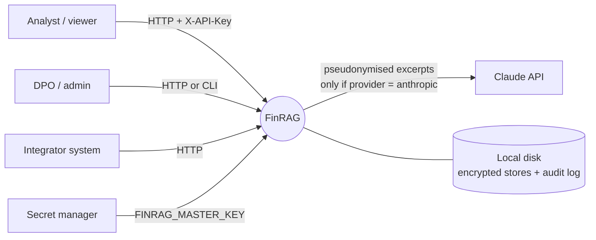

# Architecture: FinRAG

This is the architecture summary and decision record. The detailed, diagram-heavy
documents already exist and are not repeated here:

- [`../ARCHITECTURE.md`](../ARCHITECTURE.md): component, sequence and key-management diagrams
- [`../RAG_FLOW.md`](../RAG_FLOW.md): UML and user-flow diagrams naming every function and file
- [`../COMPLIANCE_MATRIX.md`](../COMPLIANCE_MATRIX.md): each rule mapped to code lines

Related: [PRD](PRD.md) · [Security](Security.md) · [Code Style](CODE_STYLE.md) · [Testing](Testing.md)

---

## 1. Context



FinRAG is a single Python service plus a CLI. The only outbound dependency is the
Anthropic API, and only when `FINRAG_LLM_PROVIDER=anthropic`.

## 2. Architectural drivers

| Driver | Consequence for the design |
|---|---|
| Personal data must not leave the organisation unprotected (GDPR Art. 25, 32, 44) | Pseudonymise before storing; local index; offline default; encrypt at rest |
| Answers must be verifiable (OWASP LLM09, EU AI Act Art. 13/14/15) | Mandatory citations, figure verification, review flag |
| Documents are untrusted input (OWASP LLM01/04) | Safe loaders, quarantine, fenced prompt, no tools |
| Compliance must be demonstrable (GDPR Art. 5(2), EU AI Act Art. 12) | Rule tags, generated matrix, tamper-evident audit log |
| Runs in constrained environments | Pure Python, no database server, no GPU, works offline |

## 3. Layers and responsibilities

```
Interfaces       finrag/web/ (browser UI, static files)
                         |  HTTP + X-API-Key
                 finrag/api.py (FastAPI)          finrag/cli.py
                          \                         /
Orchestration            finrag/pipeline.py  (single entry point)
                                  |
Domain services   ingestion/   retrieval/   generation/   governance/
Cross-cutting     security/ (crypto · pii · guardrails · access · audit)
Foundation        config.py · compliance/rules.py
```

**Dependency rule:** arrows point downwards only. The web UI is a client of the HTTP API and shares no code with the Python side. `pipeline.py` may call any domain
service; domain services never call `pipeline.py`, `api.py` or `cli.py`. `security/` and
`config.py` depend on nothing above them. There is no "raw" bypass: the API and CLI reach
data only through `FinRAGPipeline`, which applies every control.

| Package | Owns |
|---|---|
| `web/` | Browser UI: `index.html`, `styles.css`, ES modules in `js/` (no framework, no build step); calls only the HTTP API |
| `ingestion/` | Parsing files safely (`loaders.py`), splitting into chunks (`chunker.py`) |
| `retrieval/` | Encrypted per-tenant store (`store.py`), local hybrid index (`index.py`) |
| `generation/` | Prompt construction (`prompts.py`), Claude and offline generators (`llm.py`) |
| `governance/` | GDPR checks, retention, RoPA, exports (`gdpr.py`); AI disclosure, model card (`transparency.py`) |
| `security/` | Keys and encryption, PII, guardrails, RBAC, rate limit, audit |
| `compliance/` | Registry of rule IDs |

## 4. Data model

| Entity | Defined in | Stored in | Notes |
|---|---|---|---|
| `DocumentRecord` | `retrieval/store.py` | `store.enc` | Metadata only: lawful basis, purpose, `expires_at`, PII counts. No content |
| `ChunkRecord` | `retrieval/store.py` | `store.enc` | **Pseudonymised** text, location, `quarantined` flag |
| Vault entry | `security/pii.py` | `vault.enc` | token → original value, list of documents that use it |
| Audit event | `security/audit.py` | `audit/audit.log` | JSON line with HMAC chain; free text redacted |
| In-memory index | `retrieval/index.py` | memory only | Rebuilt after any change; never persisted |

Disk layout:

```
data/
├── audit/audit.log                  # 0600, append-only
└── tenants/<tenant>/                # 0700
    ├── store.enc                    # Fernet(JSON{documents, chunks})
    └── vault.enc                    # Fernet(JSON{token: {type, value, docs}})
```

## 5. Key flows

Short form; full diagrams are in [`../RAG_FLOW.md`](../RAG_FLOW.md).

**Ingest:** authorise → `load_document` → duplicate check → special-category scan and
GDPR validation → `Pseudonymiser.pseudonymise` → `chunk_sections` → `screen_context` →
`TenantStore.add_document` → audit.

**Ask:** authorise and rate-limit → `check_query` → pseudonymise question → `TenantStore.search`
→ re-screen chunks → `generator.generate` → `check_answer` → `_assess` → label → audit.

## 6. Decision records

### ADR-1: Pseudonymise before chunking and storing

- **Context.** Raw PII in chunks would end up on disk, in the index and in LLM requests.
- **Decision.** Replace PII with HMAC tokens in `FinRAGPipeline.ingest` before chunking.
  Keep originals in a separately encrypted vault.
- **Consequences.** (+) Stored data and LLM input contain no raw identifiers; same value
  gets the same token, so retrieval and aggregation still work. (−) PII the detector
  misses is stored. A model can still see token placeholders in context.
- **Rules.** `PII-PSEUDONYMISE`, `GDPR-ART4-5`, `GDPR-ART5-1C`.

### ADR-2: Local retrieval index instead of an embedding API or vector database

- **Context.** Sending chunks to an embedding service is another transfer of personal
  and confidential data.
- **Decision.** Use `HybridIndex`: BM25 plus hashed TF-IDF vectors (2^18 dimensions),
  built in memory, exact search over every chunk of the tenant.
- **Consequences.** (+) No extra processor, no network, no new service to secure; exact
  results. (−) Lexical, not semantic: paraphrases without shared words can be missed;
  cost grows linearly with chunk count. No clustering or approximate-search structures.
- **Revisit when.** A tenant exceeds roughly 100k chunks, or evaluation shows
  paraphrase misses. See §9.
- **Rules.** `GDPR-ART44`, `GDPR-ART25`, `OWASP-LLM08`.

### ADR-3: Offline generator is the default; Claude is opt-in

- **Decision.** `FINRAG_LLM_PROVIDER=offline` by default (`OfflineLLM`, extractive).
  `anthropic` uses `claude-opus-5-5` via the official SDK with adaptive thinking, effort
  `medium`, and server-side refusal fallback (`fallbacks="default"`).
- **Consequences.** (+) Nothing leaves the host unless an operator opts in. (−) Offline
  answers are quotations, not written explanations.
- **Rules.** `GDPR-ART25`, `GDPR-ART44`, `OWASP-LLM06`.

### ADR-4: The model gets no tools

- **Decision.** `AnthropicLLM.generate` passes no `tools`. The model can only produce
  text from the fenced sources.
- **Consequences.** (+) A successful injection cannot cause actions. (−) No agentic
  features such as calculators; arithmetic is done by the model and then verified against
  the sources.
- **Rules.** `OWASP-LLM06`.

### ADR-5: Guardrails are heuristic and layered

- **Decision.** Pattern-based checks on the question, on retrieved chunks and on the
  answer, **in addition to** structural defences (fenced `<source>` blocks, a static
  system prompt, a leak canary, no tools).
- **Consequences.** (+) No extra dependency, deterministic, testable. (−) Pattern
  detectors can be evaded; they are not a guarantee. The structural layer is what limits
  the damage.
- **Rules.** `OWASP-LLM01`, `OWASP-LLM07`, `EUAIA-ART15`.

### ADR-6: Tenant isolation by credential, directory and key

- **Decision.** The tenant comes only from the authenticated principal, is validated
  (`^[a-z0-9][a-z0-9_-]{0,62}$`), selects a separate directory, and keys are derived per
  tenant (`_tenant_key`).
- **Consequences.** (+) Cross-tenant retrieval is impossible by construction and
  cryptographically separated. (−) One in-process object graph per tenant; no cross-tenant
  analytics by design.
- **Rules.** `OWASP-LLM08`.

### ADR-7: Rule tags in code, registry and generated matrix

- **Decision.** Controls carry `[RULE: ID]` comments. IDs live in
  `compliance/rules.py`. `scripts/compliance_report.py` generates the matrix; tests fail
  on unknown tags, unimplemented rules, or a stale matrix.
- **Consequences.** (+) Auditors can navigate from a requirement to code. (−) Tags are
  claims, not proofs: tests, not tags, show that a control works.
- **Rules.** `GDPR-ART5-2`.

### ADR-8: Fail closed

- **Decision.** Production refuses to start without a master key or API-key file. A
  failed decryption raises and is audited. The LLM is not called when no relevant context
  exists. Errors to clients are generic.
- **Rules.** `SEC-ERROR-HANDLING`, `GDPR-ART33`.

### ADR-9: A dependency-free web UI served by the API process

- **Context.** Users need to upload files and ask questions without writing HTTP calls.
  A strict Content-Security-Policy and a small attack surface matter more here than
  framework convenience.
- **Decision.** Plain HTML, CSS and ES modules in `finrag/web/`, served by FastAPI under
  `/ui/` and switchable with `FINRAG_WEB_UI`. No bundler, no CDN, no third-party fonts or
  scripts. The UI talks to the same `/v1/*` endpoints as any client; `GET /v1/me` tells it the
  role, permissions and valid option lists (lawful bases, purposes, limits).
- **Consequences.** (+) Same origin means no CORS configuration and no cookies, so no CSRF
  surface; the CSP can forbid inline code entirely; nothing to build or audit beyond our
  own files. (−) More hand-written DOM code than a framework would need; no component
  library; client-side state is simple by design (in-memory conversation).
- **Rules.** `SEC-HEADERS`, `OWASP-LLM05`, `SEC-AUTHZ`, `GDPR-ART25`.

## 7. Deployment

| Aspect | Current design |
|---|---|
| Packaging | `Dockerfile`: `python:3.12-slim`, non-root user (uid 10001), `/data` volume (0700) |
| Process | `uvicorn finrag.api:app`; one process, state held in local files; serves the UI at `/ui/` and redirects `/` there |
| Local demo | `python scripts/demo.py` creates a key, demo users and a data directory under `data/demo/` (development only) |
| TLS | Terminated at a reverse proxy; the app sets HSTS but does not serve TLS itself |
| Secrets | `FINRAG_MASTER_KEY`, `ANTHROPIC_API_KEY`, API-key hash file injected at runtime; never in the image |
| Scheduling | `purge` command or endpoint run daily by cron / CronJob |
| CI | `.github/workflows/ci.yml`: ruff, pytest, matrix freshness, `pip-audit` |

**Limitation.** Because state is local files guarded by in-process locks, run **one
instance per data directory**. Running several replicas against one volume is unsafe.

## 8. Quality attributes

| Attribute | How it is achieved | Known limit |
|---|---|---|
| Confidentiality | Pseudonymisation, Fernet, per-tenant keys, RBAC | Detection recall |
| Integrity | Authenticated encryption, HMAC audit chain, atomic writes | Local disk is the trust boundary |
| Availability | Stateless request handling over local files | Single instance; no HA |
| Accuracy | Citations, figure verification, review flag | Heuristic confidence |
| Performance | In-memory index | Exact search is O(chunks) per query; index rebuild after every change |
| Maintainability | Small modules, one entry point, typed code, tests | See [Code Style](CODE_STYLE.md) |

## 9. Evolution path (Proposed, not built)

| Need | Change | Unchanged |
|---|---|---|
| Meaning-based search | Self-hosted embedding model behind the same `search()` interface | Pipeline, guardrails, prompts, audit |
| Large corpora | Vector database with per-tenant collections and encryption at rest; delete vectors on `delete_document`, `erase_subject`, `purge_expired` | Same |
| Higher PII recall | `PIIDetector(extra_detectors=[…])` with an NER model | Same |
| High availability | Move stores and audit to a database with row-level security; shared rate-limit state | Interfaces |
| Metrics | Structured logging and counters from the audit events | Same |

Requirements any replacement must keep: embed only pseudonymised text; one collection or
namespace per tenant taken from the credential; encryption at rest; deletion propagates
to vectors.
